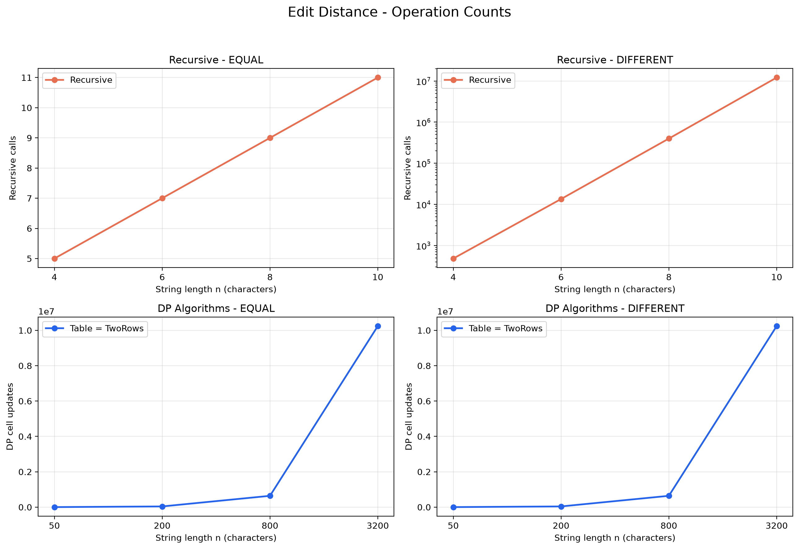
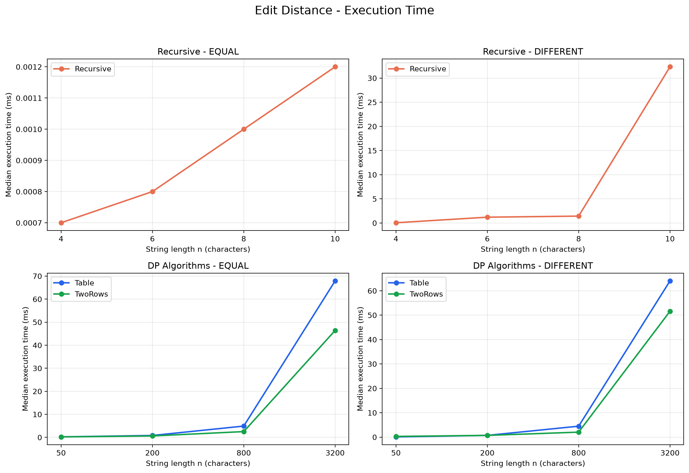
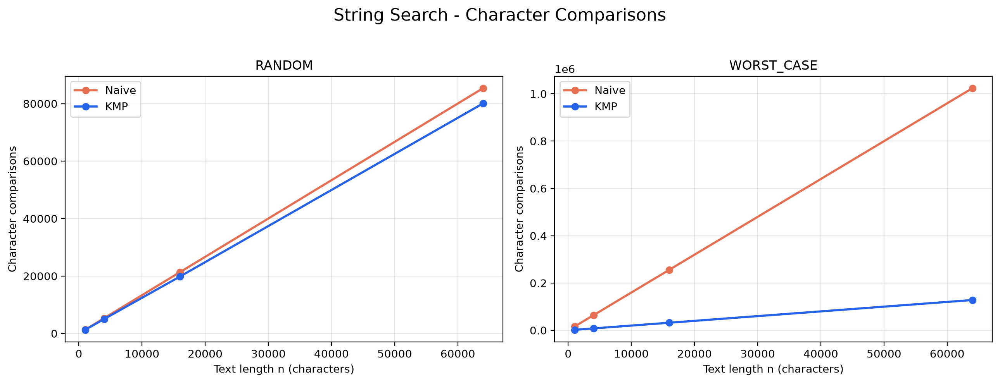
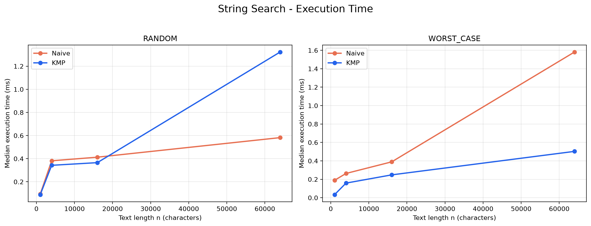

# DAA Assignment 4 — Dynamic Programming and String Algorithms

## 1. Experiment Design Card

### Research Questions

**Edit Distance:** How does the performance of Recursive, DP Table, and Two-Row Edit Distance change as string length increases?

**String Search:** How do Naive Search and KMP compare on random and specially designed worst-case inputs?

### Input Sizes

| Algorithm | Input sizes (n) |
|---|---|
| Recursive Edit Distance | 4, 6, 8, 10 |
| DP Table | 50, 200, 800, 3200 |
| Two Rows | 50, 200, 800, 3200 |
| Naive Search | 1000, 4000, 16000, 64000 |
| KMP | 1000, 4000, 16000, 64000 |

Recursive Edit Distance uses smaller sizes because it becomes extremely expensive on difficult inputs. The DP algorithms can handle significantly larger strings. String Search uses larger texts to demonstrate the differences between Naive and KMP.

Each algorithm is tested at four input sizes, with the largest at least four times the smallest.

### Input Types

**Edit Distance:**

- **EQUAL:** Both strings contain only `A`. This demonstrates performance when every character matches.
- **DIFFERENT:** One string contains only `A`, and the other contains only `B`. This forces Recursive Edit Distance to explore multiple branches.

**String Search:**

- **RANDOM:** Random text and a 16-character pattern generated from the alphabet `{A, B, C, D}`.
- **WORST_CASE:** Text contains only `A`, while the pattern consists of 15 `A` characters followed by `B`. This creates many repeated comparisons for Naive Search.

The random generator uses a fixed seed of 42 to make inputs reproducible.

### Metrics

Two types of measurements are collected:

1. **Execution time:** Measured in milliseconds using `System.nanoTime()`. Each experiment is repeated five times, and the median time is used for comparison.
2. **Algorithm operations:** Measured using counters inside the algorithms.

For Recursive Edit Distance, the counter records recursive calls. For DP Table and Two Rows, it records calculated interior cells. For String Search, it records character comparisons, including LPS construction comparisons for KMP.

The Edit Distance counters measure different units and are therefore interpreted separately.

### Predictions

- Recursive Edit Distance will grow rapidly on DIFFERENT inputs because it repeatedly explores overlapping subproblems.
- DP Table and Two Rows will both exhibit quadratic growth in cell updates.
- Two Rows will use less extra memory than DP Table.
- Naive and KMP will behave similarly on random inputs.
- KMP will perform significantly fewer comparisons on specially designed worst-case inputs.

### Planned Plots

1. Edit Distance operation counts versus string length.
2. Edit Distance execution time versus string length.
3. String Search character comparisons versus text length.
4. String Search execution time versus text length.

The Edit Distance plots use logarithmic axes where appropriate.

## 2. Experimental Results

### Plot 1 — Edit Distance Operations

**Takeaway:** Recursive calls grow extremely quickly on DIFFERENT inputs, while both DP implementations calculate the same number of cells.

For EQUAL inputs, the recursive algorithm follows only one branch at each step. For DIFFERENT inputs, it explores insertion, deletion, and replacement recursively, causing rapid growth.

Both DP implementations calculate \(n \times m\) interior cells. For strings of length 3200, this equals 10,240,000 cell updates.

### Plot 2 — Edit Distance Execution Time

**Takeaway:** Recursive Edit Distance becomes expensive even for short difficult inputs, while the DP algorithms can process much larger strings efficiently.

For DIFFERENT inputs of length 10, Recursive Edit Distance required approximately 32 ms. At length 3200, DP Table took approximately 64 ms, while Two Rows took approximately 52 ms.

Two Rows was faster than DP Table for the largest tested inputs, although both have the same theoretical time complexity.

### Plot 3 — String Search Comparisons

**Takeaway:** KMP performs significantly fewer character comparisons than Naive Search on WORST_CASE inputs.

On RANDOM inputs, the comparison counts were relatively similar.

For WORST_CASE inputs of length 64,000, Naive Search performed approximately 1.02 million comparisons, compared with approximately 128,000 for KMP.

This difference occurs because KMP uses its LPS array to avoid repeating previously established comparisons.

### Plot 4 — String Search Execution Time

**Takeaway:** Naive Search can be faster on random inputs, but KMP performs better on difficult inputs containing repeated partial matches.

At a text length of 64,000, Naive Search took approximately 0.58 ms on RANDOM input, compared with approximately 1.32 ms for KMP.

However, on WORST_CASE input, Naive Search took approximately 1.58 ms, while KMP took approximately 0.50 ms.

This demonstrates that fewer comparisons do not always guarantee lower execution time, especially when preprocessing and implementation overhead are considered.

## 3. Predictions vs. Results

### Edit Distance

The results generally matched the predictions. Recursive Edit Distance exhibited rapid growth on DIFFERENT inputs because the same subproblems were calculated repeatedly. Both DP implementations completed the same number of cell updates and handled larger inputs efficiently. Two Rows also showed better execution times on the largest inputs, although this performance difference is not guaranteed by their shared \(O(nm)\) time complexity.

### String Search

The results confirmed that KMP significantly reduces repeated comparisons on difficult inputs. However, Naive Search was faster on the largest RANDOM input despite performing slightly more comparisons. This difference can be explained by KMP's additional preprocessing and control-flow overhead. Therefore, the experiments show that theoretical complexity and measured execution time are related but not identical.

## 4. Short Answers

### 4.1 Which input made String Search slowest, and why?

The WORST_CASE input caused Naive Search to perform the most comparisons. This input contains repeated `A` characters, while the pattern ends with `B`. Naive Search repeatedly matches the first 15 pattern characters before encountering a mismatch. As a result, it performs many unnecessary comparisons, while KMP uses the LPS array to avoid repeating much of this work.

### 4.2 How large an n could Recursive Edit Distance handle, and what stopped it?

In our experiment, Recursive Edit Distance was tested up to strings of length 10. On DIFFERENT inputs of this length, it required more than 12 million recursive calls and approximately 32 ms. Larger inputs were not attempted because the number of recursive calls increases extremely quickly. We therefore limited the input size to keep the experiment practical; length 10 was our chosen limit, not a proven maximum.

### 4.3 What do we gain and lose when using Two Rows instead of the full table?

Two Rows reduces extra memory from \(O(nm)\) to \(O(m)\), where \(m\) is the length of the second string. This is useful when processing long strings because storing the complete table can consume substantial memory. Both approaches retain \(O(nm)\) execution time and return the same distance. However, Two Rows does not preserve the full table, making it more difficult to reconstruct the exact sequence of edits.

### 4.4 Which String Search algorithm would you choose for the city platform?

I would choose KMP for the city platform because it provides predictable \(O(n+m)\) worst-case execution time. It can efficiently search large text files containing repeated patterns without repeatedly moving backward through the text. Although Naive Search was faster on some random inputs, KMP performed considerably better on difficult inputs. Its stronger worst-case guarantee makes it a suitable choice for searching long log files.

## 5. Discussion of Execution Time

Measured execution times generally followed the expected complexity trends, but they were not perfectly proportional to operation counts. Execution time depends on factors such as JVM optimization, memory allocation, garbage collection, and system activity. For example, Naive Search was faster on some random inputs despite performing more comparisons than KMP. Therefore, we used the median of five runs together with algorithm-level operation counters to evaluate performance more reliably.

## 6. Conclusion

This assignment demonstrated how dynamic programming eliminates repeated calculations and how KMP improves string searching through preprocessing. Recursive Edit Distance was simple to implement but inefficient on difficult inputs. DP Table and Two Rows improved performance significantly, with Two Rows requiring less memory. The experiments also demonstrated that algorithm selection depends on input characteristics, not only theoretical time complexity.

